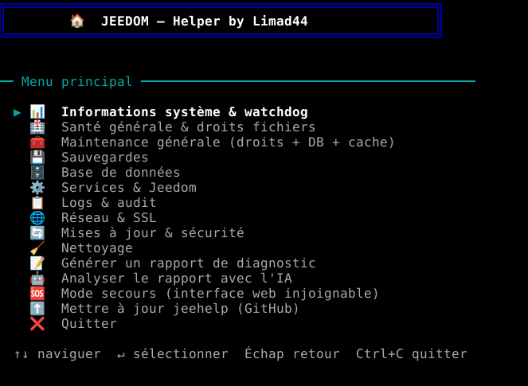
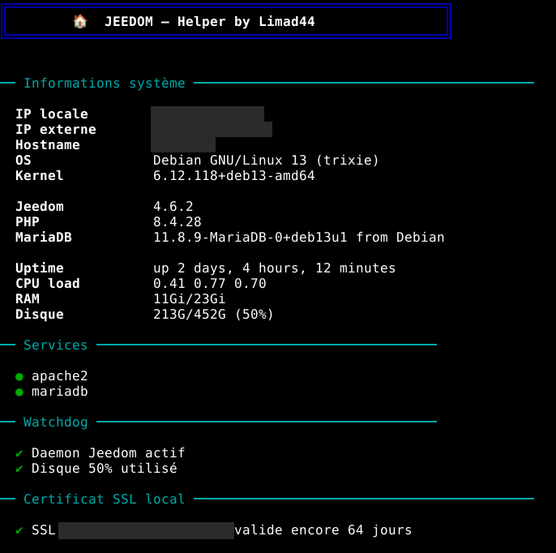
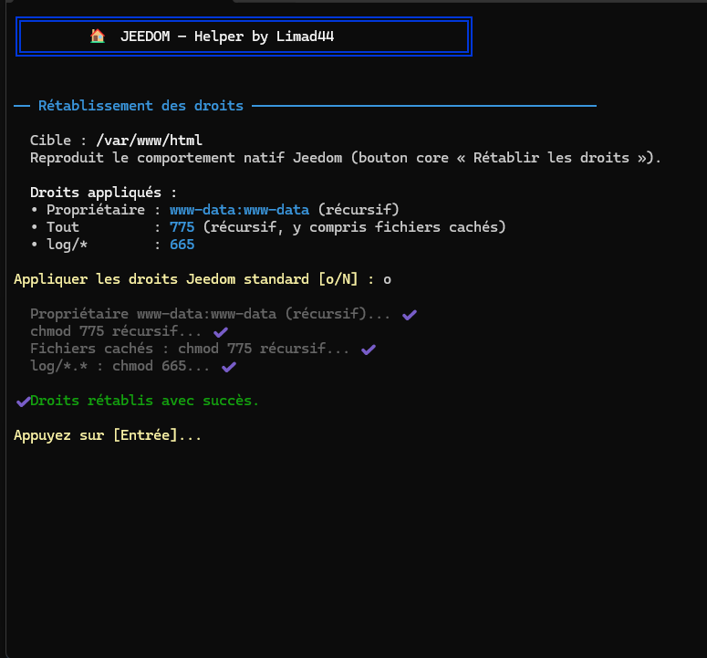
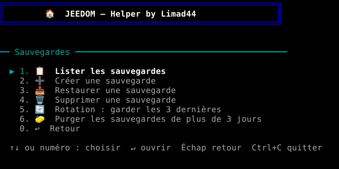

# jeehelp

Menu d'administration en ligne de commande pour une box Jeedom (Debian 11 à 13, Jeedom >= 4.4).
Un seul script bash, sans dépendance externe, pensé pour l'entretien courant d'une installation
Jeedom en SSH : sauvegardes, base de données, services, logs, réseau, mises à jour et sécurité.

Navigation interactive : ↑↓ ou numéro de l'entrée pour choisir (0 = Retour/Quitter), ENTRÉE ouvrir, ÉCHAP retour, CTRL+C quitter.


Chaque action sensible (restauration, suppression, reboot, mise à jour...) demande une
confirmation, et les actions sont journalisées dans `/var/log/jeedom-menu.log`.

### Aperçu des écrans







## Installation

Sur la box Jeedom, en une commande (avec `curl`, présent par défaut sur Jeedom) :

```bash
curl -fsSL https://raw.githubusercontent.com/limad/jeehelp/beta/install.sh | sudo bash
```

Ou avec `wget` si `curl` n'est pas disponible :

```bash
wget -qO- https://raw.githubusercontent.com/limad/jeehelp/beta/install.sh | sudo bash
```

Cela installe la commande `jeehelp` dans `/usr/local/bin/jeehelp`.

### Installation depuis un clone local

```bash
git clone https://github.com/limad/jeehelp.git
cd jeehelp
sudo bash install.sh
```

## Utilisation

```bash
limad@Jeedom:~$ jeehelp
```

Lance le menu interactif. `jeehelp` nécessite les droits root (relance automatiquement un
message d'erreur si lancé sans `sudo`) et détecte Jeedom dans `/var/www/html`.

### Menu principal

| Section | Contenu |
|---|---|
| 🩺 Diagnostic | Informations système & watchdog (OS, uptime, charge, RAM, disque, version Jeedom), contrôle de santé complet (PHP, MariaDB, services, daemon, disque, RAM, CPU, dernière sauvegarde, permissions, logs d'erreurs, SSL, mises à jour apt, processus à relancer), analyse de l'espace disque, rapport de diagnostic, analyse du rapport par IA (détails ci-dessous) |
| 🧰 Maintenance | Maintenance générale (droits + vérification/réparation de la base + cache, enchaînés), rétablissement des droits fichiers, vidage du cache Jeedom, vidage de l'OPcache du PHP servi par le web (rechargement en douceur d'Apache avec mod_php et de PHP-FPM, sans coupure), nettoyage de `/tmp` (avec aperçu et confirmation) |
| 💾 Sauvegardes | Lister, créer, restaurer, supprimer, rotation (conserve les 3 dernières), purge des sauvegardes de plus de 3 jours |
| 🗄️ Base de données | ANALYZE / REPAIR / OPTIMIZE table par table, taille des tables, vérification et réparation des tables (CHECK puis REPAIR des seules tables en erreur), dump SQL complet, import d'un dump |
| ⚙️ Services & Jeedom | État des services, redémarrage Apache/Nginx, MariaDB, moteur cron de Jeedom, relance complète de Jeedom, utilisateurs Jeedom, redémarrage du serveur |
| 📋 Logs & audit | Lister/afficher/suivre (`tail -f`) les logs Jeedom, vider tous les logs, journal système (journalctl), journal d'audit des actions jeehelp |
| 🌐 Réseau & SSL | Interfaces réseau, test de connectivité internet, ports en écoute, connexions actives, ping, vérification SSL d'un domaine |
| 🔄 Mises à jour & sécurité | **Jeedom** : vérifier, mettre à jour le core. **Système** : `apt update && upgrade`, mises à jour de sécurité immédiates, **processus à relancer** (ci-dessous), `apt autoremove`. **Automatisation** : `unattended-upgrades` sur un seul écran (configurer, simuler, statut ; le redémarrage automatique après mise à jour du noyau est **optionnel, refusé par défaut**), hook apt (ci-dessous). **jeehelp** : mise à jour depuis GitHub |
| 🆘 Mode secours | Pour quand l'interface web de Jeedom (y compris sa propre page de secours `index.php?v=d&p=database&rescue=1`) est injoignable. Teste l'accès à cette page web, et reproduit en CLI ses deux actions clés : désactiver tous les plugins, activer/désactiver le système cron. Actions journalisées dans `log/jeehelp_rescue.log` (visible depuis Jeedom une fois l'interface de nouveau accessible) en plus du journal d'audit |

### Fonctions en détail

| Fonction | Détail |
|---|---|
| ♻️ Processus à relancer | Une mise à jour remplace les bibliothèques sur disque, mais un service déjà lancé garde l'ancienne version en mémoire : le correctif de sécurité ne le protège qu'après sa relance. jeehelp les repère sans rien installer (équivalent minimal de `needrestart`, via `/proc/<pid>/maps`) et les classe : services systemd, **démons de plugins Jeedom** (lancés sous `cron.service`, ils sont relancés par Jeedom et non par `systemctl restart cron`), services dont la relance coupe réseau ou sessions (redémarrage de la box conseillé), systemd lui-même. Affiché après `apt upgrade` et les mises à jour de sécurité, avec relance proposée après confirmation (MariaDB et Docker un par un ; un démon de plugin n'est compté relancé que s'il tourne ensuite, et ne dépend ni de la session SSH ni du hook) ; aussi dans la Santé, le rapport et `sudo jeehelp --restart-check` (lecture seule, code retour 0 aucun, 1 à relancer). Limite : le code interprété (`.py`, `.php`) mis à jour n'est pas détecté |
| 🔔 Vérification après mise à jour (hook apt) | Optionnelle, désactivée par défaut (Mises à jour › Vérification automatique). Couvre les mises à jour faites la nuit par unattended-upgrades. Pose `/etc/apt/apt.conf.d/99jeehelp-restart-check` (hook `DPkg::Post-Invoke`) : apt rend la main tout de suite, la vérification part dans un timer systemd transitoire (hors du cgroup d'apt ou d'Apache), attend la fin d'apt/dpkg, puis écrit le résultat dans le journal d'audit et, s'il reste des processus à relancer, dans le **centre de messages de Jeedom** (un seul message, remplacé à chaque passage, effacé quand tout est à jour). Deux modes : **signaler seulement**, ou **signaler et relancer** Apache/Nginx (après `configtest`), PHP-FPM et les démons de plugins ; MariaDB, SSH et les autres restent seulement signalés. Sans effet si jeehelp est désinstallé ; supprimer le fichier pour le retirer |
| 💿 Analyse espace disque | Désigne l'**origine** d'un disque plein, en lecture seule (`sudo jeehelp --disk` ou Diagnostic › Analyse de l'espace disque). Couvre : taille, % utilisé et inodes de chaque disque et des tmpfs `/tmp`/`/tmp/jeedom` ; arbre des dossiers en taille et en % de l'espace utilisé ; dossier dominant (on descend tant qu'un sous-dossier pèse au moins la moitié de son parent) et action conseillée ; plus gros fichiers ; ce qui a été écrit depuis 24 h (le cas « plein du jour au lendemain ») ; **fichiers supprimés mais encore ouverts** (place rendue seulement au redémarrage du processus ou du démon de plugin, par exemple des vidéos effacées sans gain de place) ; **fichiers masqués sous un point de montage** (écrits pendant l'absence d'un NAS ou d'une clé USB) ; emplacements connus (sauvegardes et rétention Jeedom, logs, plugins les plus lourds, MariaDB avec tables, binlogs et commandes les plus historisées, journal systemd, cache apt, Docker). Un seul parcours par disque, à basse priorité (`nice`/`ionice`), compatible mawk, sans fichier temporaire sur le disque analysé. Code retour : 0 OK, 1 avertissement, 2 erreur |
| 📝 Rapport de diagnostic | Document unique mettant en évidence tout ce qui peut justifier un blocage : état du core (cron, scénarios, démarrage, date), contrôles de la page Santé, accessibilité de l'interface et de la page de secours, plugins actifs avec état des daemons et dépendances, MariaDB (connexions, taille), ressources (disque, inodes, mémoire, swap, OOM), espace disque (fichiers supprimés encore ouverts, emplacements connus ; parcours complet avec origine si un disque dépasse 75 %), services et unités en échec, erreurs fatales PHP par plugin, messages Jeedom, sauvegardes, droits, réseau, mises à jour, actions récentes de jeehelp. Synthèse des erreurs/avertissements en tête ; enregistré dans `log/jeehelp_rapport_<date>.txt` (10 derniers conservés), sans secret |
| 🤖 Analyse par IA | `sudo jeehelp --ask` envoie le rapport à une IA et affiche gravité, causes probables (avec preuves tirées du rapport) et actions proposées. **Local d'abord** (Ollama sur le réseau local), puis les autres fournisseurs du plugin `ai_assistant` (via son script CLI, sans Apache ni clé API Jeedom), puis une API directe optionnelle (seul canal si Jeedom/MariaDB sont HS). **Cloud** : rapport anonymisé (IP, MAC, hôte, chemins, logs retirés, secrets masqués) et accord demandé par fournisseur. **L'IA ne fait que proposer** : seules les actions d'un catalogue fixe (`check`, `health`, `disk`, `report`, `restart-check`, `fix-perms`, `repair-db`, `backup`, `upgrade-security`) sont reconnues, chacune demande une confirmation `[o/N]`, et rien n'est exécuté hors terminal ni à partir du texte de la réponse. Options : `--pick` (liste de choix), `--provider ID`, `--file rapport.txt`, `--channel auto\|plugin\|direct`, `--with-logs`, `--include-invalid` (proposer aussi les fournisseurs que le plugin marque invalides ; désactivés et invalides sont exclus par défaut), `--dry-run` (affiche la charge utile cloud sans rien envoyer) |

### Arborescence du menu

```text
Menu principal
├── 1. 🩺 Diagnostic
│   ├── 1. 📊 Informations système & watchdog
│   ├── 2. 🏥 Contrôle de santé complet
│   ├── 3. 💿 Analyse de l'espace disque
│   ├── 4. 📝 Générer un rapport de diagnostic
│   └── 5. 🤖 Analyser le rapport avec l'IA
│          (liste « Fournisseur IA » : Automatique, local d'abord, ou un fournisseur du plugin ai_assistant)
├── 2. 🧰 Maintenance
│   ├── 1. 🧰 Maintenance générale (droits + base + cache, enchaînés)
│   ├── 2. 🔑 Rétablir les droits fichiers/dossiers
│   ├── 3. 🧹 Vider le cache Jeedom
│   ├── 4. ⚡ Vider l'OPcache PHP
│   └── 5. 🗑️ Nettoyer /tmp
├── 3. 💾 Sauvegardes
│   ├── 1. 📋 Lister les sauvegardes
│   ├── 2. ➕ Créer une sauvegarde
│   ├── 3. 📤 Restaurer une sauvegarde
│   ├── 4. 🗑️ Supprimer une sauvegarde
│   ├── 5. 🔄 Rotation : garder les 3 dernières
│   └── 6. 🧽 Purger les sauvegardes de plus de 3 jours
├── 4. 🗄️ Base de données
│   ├── 1. 📊 Analyser (ANALYZE TABLE)
│   ├── 2. 🔧 Réparer (REPAIR TABLE)
│   ├── 3. ⚡ Optimiser (OPTIMIZE TABLE)
│   ├── 4. 📏 Taille des tables
│   ├── 5. 🔍 Vérifier et réparer les tables (CHECK/REPAIR)
│   ├── 6. 💾 Dump SQL complet
│   └── 7. 📥 Importer un dump
├── 5. ⚙️ Services & Jeedom
│   ├── 1. 📡 État des services
│   ├── 2. 🌐 Redémarrer Apache / Nginx
│   ├── 3. 🗄️ Redémarrer MariaDB
│   ├── 4. ⚙️ Redémarrer le moteur cron de Jeedom
│   ├── 5. 🔄 Relancer Jeedom complet
│   ├── 6. 👤 Utilisateurs Jeedom
│   └── 7. 💻 Redémarrer le serveur (reboot)
├── 6. 📋 Logs & audit
│   ├── 1. 📋 Lister les logs
│   ├── 2. 👁️ Afficher un log (50 lignes)
│   ├── 3. 📡 Suivre un log en temps réel (tail -f)
│   ├── 4. 🗑️ Vider tous les logs
│   ├── 5. 🔧 Journal système (journalctl)
│   └── 6. 📒 Journal des actions (audit)
├── 7. 🌐 Réseau & SSL
│   ├── 1. 🌐 Interfaces réseau
│   ├── 2. 📡 Test connectivité internet
│   ├── 3. 🔌 Ports en écoute
│   ├── 4. 🔗 Connexions actives
│   ├── 5. 📶 Ping une adresse
│   └── 6. 🔒 Vérifier SSL d'un domaine
├── 8. 🔄 Mises à jour & sécurité
│   ├── 1. 🔍 Vérifier les mises à jour Jeedom
│   ├── 2. ⬆️ Mettre à jour Jeedom (core)
│   ├── 3. 📦 Mettre à jour le système (apt update + upgrade)
│   ├── 4. 🛡️ Appliquer les mises à jour de sécurité maintenant
│   ├── 5. ♻️ Processus à relancer après mise à jour
│   ├── 6. 🧽 Supprimer les paquets inutiles (apt autoremove)
│   ├── 7. 🔒 Mises à jour de sécurité automatiques (unattended-upgrades)
│   │   ├── 1. 🔒 Installer et configurer
│   │   ├── 2. 🧪 Simuler (sans rien appliquer)
│   │   └── 3. 📊 Statut et dernier journal
│   ├── 8. 🔔 Vérification automatique après mise à jour (hook apt)
│   └── 9. ⬆️ Mettre à jour jeehelp (GitHub)
├── 9. 🆘 Mode secours (interface web injoignable)
│   ├── 1. 🔗 Tester l'accès à la page de secours web
│   ├── 2. 🧩 Désactiver tous les plugins
│   ├── 3. ⏱️ Désactiver le système cron
│   └── 4. ⏱️ Activer le système cron
└── 0. ❌ Quitter
```

Chaque sous-menu se termine par « 0. ↩ Retour » (ou la touche ÉCHAP). Taper le numéro d'une entrée puis ENTRÉE l'ouvre directement : par exemple `8`, ENTRÉE, `5`, ENTRÉE pour les processus à relancer.

### Depuis un autre poste (SSH)

Le menu a besoin d'un terminal : ajoutez `-t` à la commande SSH (sans lui : « Aucun terminal détecté »).

```bash
ssh -t utilisateur@box "sudo jeehelp"
```

Les options CLI ci-dessous fonctionnent sans `-t` : `ssh utilisateur@box "sudo jeehelp --check"`.

**Télécharger une sauvegarde** sur votre poste (sans `-t`, le flux est binaire) :

```bash
ssh utilisateur@box "sudo jeehelp --download"                              # liste numérotée (1 = la plus récente)
ssh utilisateur@box "sudo jeehelp --download 1" > sauvegarde.tar.gz        # télécharge la n°1
```

Archives Jeedom (`*.tar.gz`) et dumps SQL (`dump_*.sql.gz`) sont proposés, du plus récent au plus ancien. Le nom, la taille et le sha256 sont affichés sur stderr pour vérifier l'intégrité ; le script refuse d'écrire du binaire sur un terminal. Chaque téléchargement est journalisé. Une sauvegarde contient des secrets : stockez-la en lieu sûr.

### Mode CLI (non-interactif)

```bash
sudo jeehelp --backup            # Lancer une sauvegarde Jeedom
sudo jeehelp --self-update       # Mettre jeehelp à jour depuis GitHub (aperçu + confirmation ; --yes sans question, --branch alpha)
sudo jeehelp --download [N]      # Lister les sauvegardes, ou envoyer la N-ième sur stdout (voir SSH ci-dessus)
sudo jeehelp --repair-db         # REPAIR TABLE sur toutes les tables
sudo jeehelp --check             # Vérification rapide (watchdog + SSL)
sudo jeehelp --health            # Health check complet (équivalent à Diagnostic › Contrôle de santé)
sudo jeehelp --disk              # Analyse de l'espace disque : origine, tailles et % par dossier (lecture seule)
sudo jeehelp --report            # Rapport de diagnostic complet (code retour : 0 OK, 1 avertissement, 2 erreur)
sudo jeehelp --ask               # Analyse du rapport par IA (voir ci-dessous)
sudo jeehelp --fix-perms         # Rétablir les droits fichiers de /var/www/html
sudo jeehelp --upgrade-security  # Lancer unattended-upgrade immédiatement
sudo jeehelp --restart-check     # Services et démons restés sur d'anciennes bibliothèques (lecture seule)
```

Utile pour un cron ou un script d'automatisation externe à Jeedom (ex. `jeehelp --check` en
cron quotidien, ou `jeehelp --backup` avant une mise à jour manuelle).

## Mise à jour

```bash
sudo jeehelp --self-update
```

Télécharge la dernière version depuis la branche `beta`, vérifie la syntaxe, affiche un aperçu
(empreintes, lignes modifiées, dernier commit) et demande confirmation avant de remplacer
`/usr/local/bin/jeehelp`. L'ancienne version est gardée dans `/usr/local/bin/jeehelp.prev`
(retour arrière : `sudo cp /usr/local/bin/jeehelp.prev /usr/local/bin/jeehelp`).
Options : `--yes` (sans confirmation, pour un script) et `--branch alpha` (version de test).
Relancer la commande d'installation reste possible et donne le même résultat.

## Analyse par IA : configuration

Rien n'est requis si le plugin `ai_assistant` a au moins un fournisseur configuré. Fichier optionnel `/etc/jeehelp/ai.conf` (root, mode 600) :

```ini
AI_ALLOWED_CLOUD="2386 direct"   # fournisseurs cloud déjà autorisés (rempli par l'accord interactif)
AI_ORDER="2981 2386"             # ordre de préférence des fournisseurs cloud
AI_DIRECT_URL="https://api.openai.com/v1/chat/completions"   # canal direct (API compatible OpenAI)
AI_DIRECT_MODEL="gpt-4o-mini"
AI_DIRECT_KEY="..."              # facultatif (inutile pour un Ollama local)
```

Le script `plugins/ai_assistant/core/php/ai_assistant.cli.php` (`list`, `ask`) est fourni par le plugin ; il refuse les équipements en mode `jeeAssist` sans confirmation et ceux dont le repli entre fournisseurs est actif.
